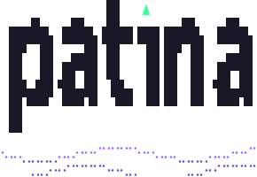

  <picture>
    <source media="(prefers-color-scheme: dark)" srcset="assets/wordmark-dark.svg">
    
  </picture>

<h3 align="center">A new OS you can just ask. And it asks you first.</h3>

  The free alternative to Windows and macOS, for x86-64 and ARM. 
  A complete desktop with its own assistant, kortex, on Debian and KDE Plasma.

  <a href="https://github.com/patina-os/patina"><b>patina</b></a> ·
  <a href="https://github.com/patina-os/kortex"><b>kortex</b></a> ·
  <a href="https://github.com/patina-os/patina/blob/main/docs/roadmap.md">Roadmap</a> ·
  <a href="https://github.com/patina-os/patina/releases">Releases</a>

  
   Windows key and Space, then <code>ai</code> and your request. It runs on your machine and asks before every change.

  
   A fresh install, in dark mode. Alpha on Debian 13; the installer image is next.

Free software, GPL-3.0-or-later. Based on Debian, with KDE Plasma. Debian is a
trademark of Software in the Public Interest, Inc.; KDE and Plasma are trademarks of KDE
e.V. Not affiliated.

