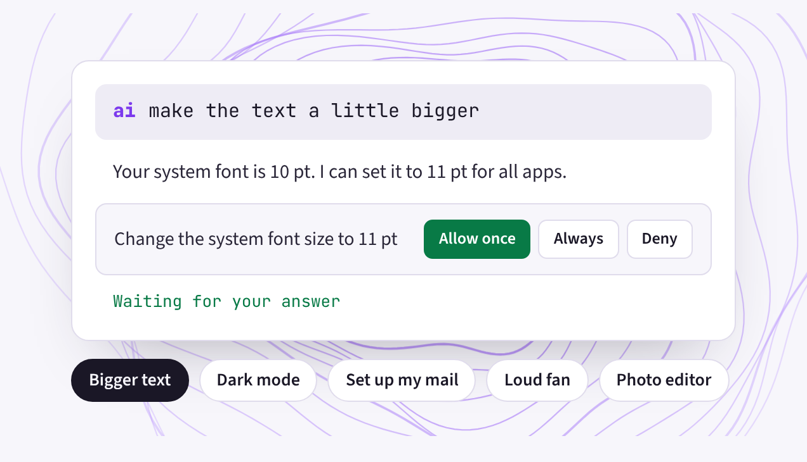
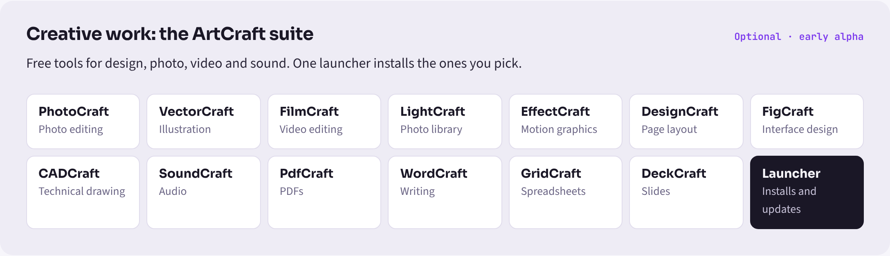

  <picture>
    <source media="(prefers-color-scheme: dark)" srcset="assets/wordmark-dark.svg">
    
  </picture>

<h3 align="center">A new OS you can just ask. And it asks you first.</h3>

  The free alternative to Windows and macOS, for x86-64 and ARM. 
  A complete desktop with an assistant built in, on Debian and KDE Plasma.

  
  
  
  

  <a href="https://github.com/patina21/patina"><b>patina</b></a> ·
  <a href="https://github.com/patina21/kortex"><b>kortex</b></a> ·
  <a href="https://github.com/patina21/patina/blob/main/docs/roadmap.md">Roadmap</a> ·
  <a href="https://github.com/patina21/patina/releases">Releases</a>

  

## The assistant

Press the Windows key and Space, then type `ai` and your request.

- **Runs on your machine.** What you ask never leaves it, and it works offline.
- **Shows before it changes.** Every change waits for you: Allow once, Always, or Deny.
- **Yours to choose.** Prefer the cloud? Pick a provider, European ones first. Or switch it off.

  
   A fresh install, in dark mode. The screenshot is unedited.

## Everything you need is already there

One good, free app for every everyday job.

| Mail and calendar | Files everywhere | Documents | Passwords |
|---|---|---|---|
| **Thunderbird** All your accounts in one inbox. | **Nextcloud** Sync in the EU or on your own server. | **Euro-Office** Opens Word, Excel and PowerPoint files. | **KeePassXC** Passwords in a file only you hold. |
| **The web** | **Chat** | **Photos, video, PDFs** | **Music and more** |
| **Firefox ESR** Telemetry and sponsored content off. | **Element** Encrypted chat on Matrix. | **Gwenview, Haruna, Okular** Photos, video and PDFs. | **Tauon, Zed** Music, and code when you get curious. |

### Creative work: the ArtCraft suite

Optional, early alpha. Free tools for design, photo, video and sound. One launcher installs the ones you pick.

  

## What patina stands for

- **Free software by default.** Every app it installs is free and open source. Anything else is opt-in.
- **Your data stays close.** No account to create, no telemetry. Your files sync where you choose.
- **A new OS on a trusted base.** Debian 13 underneath. Security updates come straight from Debian.

## Where things stand

| **Now** | Next | Then | Then |
|---|---|---|---|
| **Alpha on Debian 13** Install Debian, run one command. | **The installer image** Boot from USB, answer a few questions. | **Tested on ARM** Raspberry Pi and Snapdragon laptops. Not Apple Silicon. | **Version 0.1** The first release for everyone. |

Watch [patina](https://github.com/patina21/patina) to hear when the installer is ready.
Star it if you want this to exist.

## Repositories

| | |
|---|---|
| [**patina**](https://github.com/patina21/patina) | the OS: the look, the apps, the settings and the assistant's setup |
| [**kortex**](https://github.com/patina21/kortex) | the assistant in the command palette |

Every line is public and GPL. patina builds on what Debian and KDE do well, and adds
nothing that needs its own security team. Themes and fixes are welcome.

patina is based on Debian, with KDE Plasma. GPL-3.0-or-later. Debian is a trademark
of Software in the Public Interest, Inc.; KDE and Plasma are trademarks of KDE e.V. Not
affiliated.
